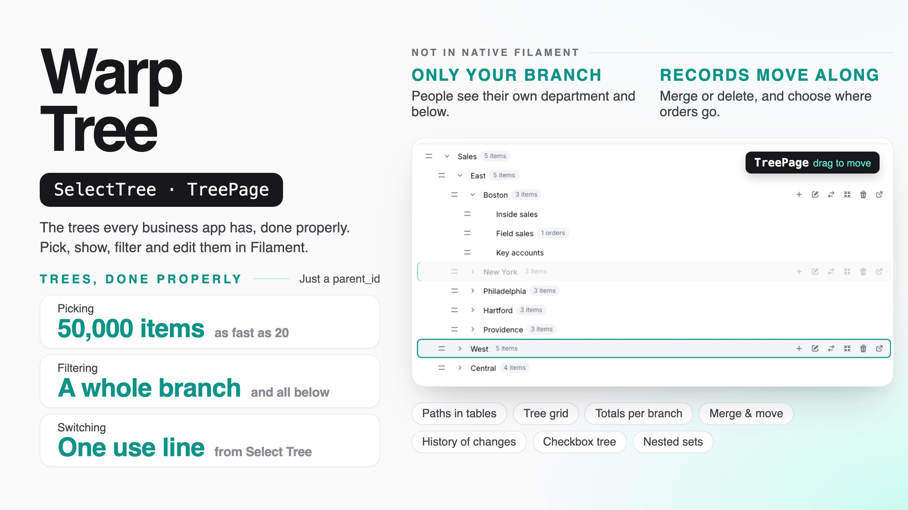

# Warp Tree

**Departments, product categories, charts of accounts, folders: the trees every business app has, done properly in Filament. Pick from a tree of 50,000 items as fast as from 20, show the path in tables, filter a table by a branch, let people see only their own branch, and edit the tree by dragging — with the records that hang on an item moved along when you merge or delete it.**

<a href="https://demo.warpui.com/tree"></a>

Open a department, search *“inside bos”*, drag a team to another branch, and merge two categories with their products — at **[demo.warpui.com/tree](https://demo.warpui.com/tree)**. No sign-up needed; the data is reset every hour.



- [What it does](#what-it-does)
- [Installation](#installation)
  - [AI coding assistants (Laravel Boost)](#ai-coding-assistants-laravel-boost)
- [Choosing from a tree](#choosing-from-a-tree)
  - [Checkboxes on a tree](#checkboxes-on-a-tree)
  - [Editing a tree inside a form](#editing-a-tree-inside-a-form)
  - [Coming from codewithdennis/filament-select-tree](#coming-from-codewithdennisfilament-select-tree)
  - [Showing the path in tables and infolists](#showing-the-path-in-tables-and-infolists)
  - [Validation rule](#validation-rule)
- [Filtering a table by a branch](#filtering-a-table-by-a-branch)
- [A tree next to a table](#a-tree-next-to-a-table)
- [The rows of a table as a tree](#the-rows-of-a-table-as-a-tree)
- [Working with the tree in code](#working-with-the-tree-in-code)
- [Who sees what](#who-sees-what)
- [Editing the tree](#editing-the-tree)
  - [Rows: badges, descriptions, your own buttons, a modal to edit](#rows-badges-descriptions-your-own-buttons-a-modal-to-edit)
  - [Several items at once, all branches, CSV](#several-items-at-once-all-branches-csv)
  - [A depth limit](#a-depth-limit)
  - [The tree as a widget](#the-tree-as-a-widget)
  - [In a relation manager](#in-a-relation-manager)
- [Multi-tenancy](#multi-tenancy)
- [Testing](#testing)
- [Requirements](#requirements)
- [Support](#support)
- [License](#license)

## What it does

| You want… | Use |
| --- | --- |
| Departments and categories from a tree of any size, with the path shown | [`SelectTree`](#choosing-from-a-tree) |
| Checkboxes on a tree, where a parent can be checked, partly checked or empty | [`CheckboxTree`](#checkboxes-on-a-tree) |
| A small tree edited inside the form of its record (menu links, chapters), saved as JSON or as rows | [`TreeBuilder`](#editing-a-tree-inside-a-form) |
| To switch from codewithdennis/filament-select-tree by changing one line | [`Compat\SelectTree`](#coming-from-codewithdennisfilament-select-tree) |
| *Sales › East › Boston* in tables and infolists | [`TreePathColumn`, `TreePathEntry`](#showing-the-path-in-tables-and-infolists) |
| A table filtered by a branch, including everything under it | [`TreeFilter`](#filtering-a-table-by-a-branch) |
| The tree on the left of a list page: click a branch to filter the table, drag rows onto a branch to move them | [`HasTreeNavigation`](#a-tree-next-to-a-table) |
| A table whose rows are the tree — a chart of accounts or a budget — with totals on the parent rows and indent / outdent | [`->warpTree()`, `HasTreeGrid`](#the-rows-of-a-table-as-a-tree) |
| *Orders of East and below* in your own queries | [`HasTree`, `whereInSubtree()`](#working-with-the-tree-in-code) |
| People who see only their own branch | [`visibleSubtree()`, `ScopedToVisibleSubtree`](#who-sees-what) |
| A page to drag, rename, add, merge and delete items — with the records moved along | [`TreePage`](#editing-the-tree) |
| The same tree on a dashboard, or for the items of one record | [`TreeWidget`](#the-tree-as-a-widget), [`TreeRelationManager`](#in-a-relation-manager) |
| A tree that never gets deeper than three levels | [`$maxDepth`](#a-depth-limit) |
| Only items of the tree accepted by your API | [`TreeNode`](#validation-rule) |

Every part:

- **is a drop-in replacement.** `SelectTree` extends `Select`, `TreePathColumn` extends `TextColumn`, `TreeFilter` is a table filter and `TreePage` a resource page. `required()`, `multiple()`, `relationship()`, `live()`, validation and policies keep working.
- **works where forms live:** in repeaters you can reorder, builders, tabs, wizards, modals and modals inside modals, relation managers, on create and edit pages, with `live()` and `$set`, and in SPA mode.
- **reads only what is on the screen.** Branches are read when they are opened, a page at a time, so a tree of 50,000 items costs the same as one of 20.
- **works with the columns you already have:** a `parent_id` column is all it needs. Optionally, nested-set columns (`_lft`, `_rgt`) read whole branches in one query. No extra package is required: Warp Tree keeps those columns up to date itself, and if your model already uses [kalnoy/nestedset](https://github.com/lazychaser/laravel-nestedset) (v6 or v7), it lets that package move the items.
- **speaks ten languages** (English, Japanese, German, French, Spanish, Italian, Brazilian Portuguese, Korean, simplified and traditional Chinese).

## Installation

> **Warp Tree is a commercial plugin.** A license is required. After purchase you receive credentials for the private Composer repository.

```bash
composer config repositories.qalainau composer https://qalainau.privato.pub/composer
composer config --auth http-basic.qalainau.privato.pub "your-email" "your-license-key"

composer require qalainau/filament-warp-tree
php artisan filament:assets
```

> Run `php artisan filament:assets` again after every update of the package.

Add the plugin to your panel:

```php
use Qalainau\FilamentWarpTree\FilamentWarpTreePlugin;

$panel->plugin(FilamentWarpTreePlugin::make());
```

Only if you use the tree page (`TreePage`) or indent rows in a [tree grid](#the-rows-of-a-table-as-a-tree), run `php artisan migrate` too: it creates `warp_tree_changes` for the history. To edit the migration, publish it first with `php artisan vendor:publish --tag=filament-warp-tree-migrations`.

### AI coding assistants (Laravel Boost)

Warp Tree ships instructions for AI coding assistants such as Claude Code, Cursor and Codex. If your app uses
[Laravel Boost](https://laravel.com/docs/boost), the assistant learns from them which Warp Tree part replaces which Filament component, what each one saves, and how to test it.

- **Guidelines** (`resources/boost/guidelines/core.md`): a short summary that Boost adds to `CLAUDE.md`, `AGENTS.md` and the other agent files. It also points the assistant to this README in `vendor/`, so it reads the documentation of the version you have installed.
- **Skill** `warp-tree-development` (`resources/boost/skills/`): an example for every part, and tests. The assistant loads it when it works on trees.

When `php artisan boost:install` asks "Which third-party AI guidelines/skills would you like to install?", select `qalainau/filament-warp-tree`. To do it without the question, add the package to `boost.json` and run the command again:

```json
{
    "packages": ["qalainau/filament-warp-tree"]
}
```

```bash
php artisan boost:install --guidelines --skills -n
```

## Choosing from a tree

`SelectTree` picks an item from a tree: departments, product categories, a chart of accounts. It replaces `Select` and keeps everything you know from it (`relationship()`, `multiple()`, `required()`, `disabled()`, `live()`, `placeholder()` …). Saving to a `BelongsTo` or `BelongsToMany` relationship works exactly like Filament's `Select`.

```php
use Qalainau\FilamentWarpTree\Forms\SelectTree;

SelectTree::make('department_id')
    ->relationship('department', 'name', parentAttribute: 'parent_id')
```

What it does:

- **Fast on large trees.** Only the branch you open is read from the server, 100 items at a time (*"Show more…"* loads the next ones). Each item shows how many items are directly under it. Nothing is loaded until the list is opened, so a form with a tree of 50,000 departments opens as fast as one with 20.
- **Search with context.** Typing searches on the server and shows each match inside the branches it belongs to: *Sales › East › Boston › **Inside sales***. The words may be spread over the path, so `inside bos` finds *Inside sales* under *Boston*. Full-width characters are read as half-width (`ｂｏｓ` finds *Boston*). The search starts when typing pauses for 0.3 s.
- **The path, not just the name.** The chosen item is shown with its parents: *Sales › East › Boston*. When the list opens again, the branches leading to the chosen item are opened and it is scrolled into view.
- **Keyboard.** ↑ ↓ move, → opens a branch (and then goes into it), ← closes it (and then goes to the parent), Enter chooses, Esc closes the list and returns to the field. Backspace on a closed, optional field clears it.
- **Screen readers.** The list is a `tree` with `treeitem`s that carry `aria-level`, `aria-expanded`, `aria-selected`, `aria-setsize` and `aria-posinset`; the search box points at the highlighted item with `aria-activedescendant`, and choices are announced.

A complete example:

```php
use App\Models\Category;
use Illuminate\Database\Eloquent\Builder;

// Only the lowest level can be chosen; clicking a group opens it
SelectTree::make('category_id')
    ->relationship('category', 'name', modifyQueryUsing: fn (Builder $query) => $query->where('active', true))
    ->nestedSet()            // _lft / _rgt columns (kalnoy/nestedset): parents in one query
    ->leavesOnly()
    ->required()

// Several departments; choosing a department also chooses everything under it
SelectTree::make('departments')
    ->multiple()
    ->relationship('departments', 'name')
    ->selectDescendants()

// A tree written as an array
SelectTree::make('account')
    ->tree([
        '1000' => ['label' => 'Assets', 'children' => [
            '1110' => 'Cash',
            '1120' => 'Bank accounts',
        ]],
        '4000' => ['label' => 'Income', 'children' => ['4100' => 'Product sales']],
    ])
    ->leavesOnly()

// A whole table, without a relationship (filters, settings pages)
SelectTree::make('region_id')->tree(Region::class, 'name')
```

| Method | What it does |
| --- | --- |
| `relationship(string $name, string $titleAttribute, ?Closure $modifyQueryUsing = null, bool $ignoreRecord = false, string $parentAttribute = 'parent_id')` | The tree is the related model's table. `parentAttribute` is the column that points at the parent; roots have `null` there. `modifyQueryUsing` is applied to every query (children, counts, search, paths). |
| `tree(array\|Closure\|string $tree, string $titleAttribute = 'name', string $parentAttribute = 'parent_id', ?Closure $modifyQueryUsing = null)` | A tree without a relationship: an array (`[value => label]` or `[value => ['label' => …, 'children' => […]]]`, or a list of `['value' => …, 'label' => …, 'children' => […]]`), a model class, or a closure that returns a query. |
| `nestedSet(string $left = '_lft', string $right = '_rgt')` | Use nested-set columns to read all parents (for paths and search) and all descendants in one query. The parent column is still needed. |
| `leavesOnly(bool $condition = true)` | Only items without children can be chosen. Clicking a group opens it. The server refuses a group even if the browser is bypassed. |
| `selectDescendants(bool $condition = true)` | With `multiple()`: choosing an item also chooses everything under it, and removing it removes them. The server expands the selection before saving, so values from the API are saved the same way. With `leavesOnly()`, choosing a group chooses only the lowest items under it. |
| `maxDescendants(int $limit)` | The most items one click may add with `selectDescendants()` (default 1,000). |
| `pathSeparator(string $separator)` | What goes between the parts of a path (default `' › '`). |
| `pageSize(int $size)` | How many children are read at once (default 100, at most 500). |
| `searchLimit(int $limit)` | How many matches a search shows (default 50). Below that, the list says to type more. |
| `searchable(array $columns)` | Search other columns as well as the title, as with `Select`. |
| `getOptionLabelFromRecordUsing(Closure $callback)` | Build each label from the record, as with `Select`. |
| `disabledOptions(array\|Closure $values)` | Items shown greyed out that can't be chosen (Filament's `disableOptionWhen()` works too). The server refuses them, but a value the record already has can be kept. |
| `hiddenOptions(array\|Closure $values)` | Items left out, with everything under them. The server refuses them. |
| `prepend(array\|Closure $items)` / `append(array\|Closure $items)` | Items that are not in your table, before or after the roots — *No department* (`[-1 => 'No department']`). Written like an array tree; the server accepts them. |
| `withCount(bool $condition = true)` | Show how many items are directly under each branch (default on). |
| `icon(string\|BackedEnum\|Htmlable\|Closure $icon)` / `leafIcon(…)` | An icon before each item, and another before the items with nothing under them — see [Icons](#icons). |
| `defaultOpenLevel(int $level)` | Open the branches down to this level when the list opens (1 shows the children of the roots). |
| `expandSelected(bool $condition = true)` | Open the branches down to the chosen item when the list opens (default on). |
| `direction('auto'\|'top'\|'bottom')` | Open the list below the field (`auto`: above when there is no room) or always above. |
| `staticList(bool $condition = true)` | Put the open list under the field instead of over the fields below. |
| `alwaysOpen(bool $condition = true)` | Keep the list open under the field. |
| `clearable(bool $condition = true)` | Show the button that clears an optional single field (default on). |
| `badges(bool $condition = true)` / `selectedCountLabel(string $label)` | With `multiple()`: one badge per item, or *5 selected* (`selectedCountLabel(':count departments')`). |
| `groupedBadges(bool $condition = true)` | With `selectDescendants()`: show one badge for a parent chosen with everything under it (default on). |
| `keyAttribute(string $attribute)` | The column that holds the item's value and that the parent column points at, when it is not the model key (`code` and `parent_code`). |
| `parentNullValue(int\|string $value)` | The parent column holds this value for roots (`0`, `-1`) instead of `null`. |
| `orphansAsRoots(bool $condition = true)` | Show items whose parent is filtered out (by `modifyQueryUsing`) as roots. Off by default: such items can't be reached by opening branches, so they are not offered. |
| `withTrashed(bool $condition = true)` | Include soft-deleted items. |
| `onlyVisibleSubtree(bool $condition = true)` | Offer only the branch the person may see — see [Who sees what](#who-sees-what). |

### Icons

`icon()` puts an icon before every item — in the list, on the chosen value and on the badges. `leafIcon()` puts another one before the items with nothing under them, so groups and the last level look different:

```php
use Filament\Support\Icons\Heroicon;

SelectTree::make('category_id')
    ->relationship('category', 'name')
    ->icon(Heroicon::OutlinedFolder)
    ->leafIcon(Heroicon::OutlinedTag)

// One icon per item, decided from the record ($hasChildren tells branches from the last level)
SelectTree::make('department_id')
    ->relationship('department', 'name')
    ->icon(fn (Department $record, bool $hasChildren): ?string => $record->icon)   // null: no icon (or leafIcon())

// An array tree: write the icon on the item
SelectTree::make('account')->tree([
    '1000' => ['label' => 'Assets', 'icon' => Heroicon::OutlinedBanknotes, 'children' => ['1110' => 'Cash']],
])
```

Any Filament icon works: a `Heroicon` case, a Blade Icons name (`'heroicon-o-folder'`, `'tabler-folder'`), an image path or `Htmlable`. The icon is decided where the item is read, so a branch shows its new icon as soon as something is put under it. Each icon's SVG is sent once per request however many items use it, so icons don't make a branch of 100 items heavier. `TreeFilter` takes the same `icon()` and `leafIcon()`, and the tree page has `getTreeIcon()` ([Editing the tree](#editing-the-tree)).

**Adding an item from the field.** `createOptionForm()` works as with `Select`: the *+* button opens a modal, the new item is chosen, and the list reads the tree again so the new item is in it.

```php
SelectTree::make('department_id')
    ->relationship('department', 'name')
    ->createOptionForm([TextInput::make('name')->required()])
```

**What is saved.** The item's key, like `Select` (an integer for integer keys). With `multiple()`, an array of keys, or the pivot rows of a `BelongsToMany` relationship (as with Filament's `Select`, a relationship field is saved by `saveRelationships()` and is not in `$form->getState()`). With `selectDescendants()`, the parent and every item under it are saved, so queries such as "orders visible to this department" stay simple.

**Edge cases.**

- Only items you can reach by opening branches are offered. If `modifyQueryUsing` hides a parent, its children are not offered and are not found by search, and saving one is refused.
- A tree with a loop (an item that is its own ancestor) does not hang: the path stops where the loop starts.
- Values sent by the browser that can't be keys (`'abc'` for an integer key) are ignored before they reach the database, so PostgreSQL doesn't fail.
- In an array tree every value must be unique; the same value twice throws an `InvalidArgumentException`.

### Checkboxes on a tree

`CheckboxTree` shows the tree inside the form with a checkbox on every item — for a role's permissions, the departments that may see a report, the teams to notify. A parent has **three states**: checked when everything under it is checked, a dash when only some of it is, empty otherwise.

```php
use Qalainau\FilamentWarpTree\Forms\CheckboxTree;

CheckboxTree::make('departments')
    ->relationship('departments', 'name')            // a BelongsToMany, saved like Select's

// Permissions written as an array; the keys are what is saved
CheckboxTree::make('permissions')
    ->tree([
        'orders' => ['label' => 'Orders', 'children' => ['orders.view' => 'View', 'orders.edit' => 'Edit']],
        'reports' => 'Reports',
    ])
    ->defaultOpenLevel(1)
```

It extends `SelectTree`, so the tree is given the same way (`relationship()`, `tree()`, `nestedSet()`, `keyAttribute()` …) and `disabledOptions()`, `hiddenOptions()`, `icon()`, `onlyVisibleSubtree()`, `required()`, `disabled()`, `live()` and the validation work as there. Only the opened branches are read, so it suits large trees too.

- **Checking a parent** checks everything under it, and unchecking an item unchecks its parents (they turn into a dash). When the last unchecked item under a parent is checked, the parent is checked too. Clicking a parent that shows a dash checks everything under it.
- **The server decides.** Each click asks the server for the new value, because the items under a parent may be in branches that were never opened. The answer also says which parents get a dash.
- **What is saved** is every checked item, parents included (`[3, 7, 8, 9]`), as with `SelectTree::selectDescendants()` — so *orders visible to this department* stays a simple `whereIn`. Values that arrive without the browser (API, tests) are expanded the same way before saving, and refused if they are not in the tree.
- **Keyboard**: ↑ ↓ move, → ← open and close, Space or Enter checks. Screen readers hear `aria-checked` as *checked*, *mixed* or *not checked*.

| Method | What it does |
| --- | --- |
| `cascade(bool $condition = true)` | Checking a parent checks everything under it (default on). With `cascade(false)` every item is checked on its own, and a dash on a parent only means that something under it is checked. |
| `maxHeight(string $height)` | The height at which the tree starts to scroll inside the field (default `22rem`). |
| `treeSearchable(bool $condition = true)` | The search box above the tree (default on). |
| `maxDescendants(int $limit)` | The most items one click may check (default 5,000). |
| `defaultOpenLevel(int $level)` · `withCount()` · `pageSize()` · `searchLimit()` | As in `SelectTree`. |

Items that can't be chosen (`disabledOptions()`) are skipped when a parent is checked; the parents above such an item then show a dash instead of a check. `leavesOnly()` is not supported: to store only the lowest level, filter the state in `dehydrateStateUsing()`. A parent with more than 500 direct children is not checked automatically when its last child is checked.

### Editing a tree inside a form

`TreeBuilder` is a field for a small tree that belongs to the record being edited — the links of a menu, the chapters of a manual, a bill of materials. People add, edit and delete items in modals, drag them by the handle to reorder or nest them (or use **Alt + ↑ ↓ → ←**), and the whole tree is saved with the form.

```php
use Filament\Forms\Components\TextInput;
use Qalainau\FilamentWarpTree\Forms\TreeBuilder;

TreeBuilder::make('links')                              // a JSON column: cast it to array on the model
    ->schema([                                          // the form for adding and editing an item
        TextInput::make('label')->required(),
        TextInput::make('url'),
    ])
    ->itemDescription(fn (array $item): ?string => $item['url'] ?? null)
    ->maxDepth(3)
```

The value is a nested array:

```php
[
    ['label' => 'Home', 'url' => '/', 'children' => []],
    ['label' => 'Products', 'url' => '/products', 'children' => [
        ['label' => 'Bolts', 'url' => '/bolts', 'children' => []],
    ]],
]
```

**Saved as rows instead.** With `relationship()`, the items are rows of a `HasMany` (or `MorphMany`) relationship of the form's record, linked to each other by a parent column:

```php
TreeBuilder::make('items')
    ->relationship('items', parentAttribute: 'parent_id', orderAttribute: 'sort')   // Menu::items()
    ->labelKey('label')
    ->schema([TextInput::make('label')->required(), TextInput::make('url')])
```

When the form is saved, rows are updated, added and deleted to match the tree, with their parent and order taken from where they are in it. Only the label and the fields of `schema()` are written. A row id that does not belong to this record — whatever the browser sends — is never updated: such an item is added as a new row.

| Method | What it does |
| --- | --- |
| `schema(array\|Closure $components)` · `form(...)` | The fields of an item, shown in the add and edit modals. Without it, an item has only its name. If the fields don't include the label, a name field is put first. |
| `labelKey(string $key)` · `childrenKey(string $key)` | The keys that hold the name and the items under it (defaults `label` and `children`). |
| `maxDepth(?int $depth)` | How many levels the tree may have. Items at the limit get no *add* button and take no drops inside; the server refuses deeper moves and a deeper state. |
| `itemDescription(?Closure $callback)` | A second line under the name: `fn (array $item): ?string`. |
| `addable()` · `editable()` · `deletable()` · `reorderable()` | Turn a part off (`->deletable(false)`), with a boolean or a closure. A disabled field turns them all off. |
| `relationship(?string $name = null, string $parentAttribute = 'parent_id', ?string $orderAttribute = null)` | Save the items as rows of a relationship instead of an array. |

Good to know:

- **It is for small trees** — tens or a few hundred items. The whole tree lives in the form's state and is drawn on every change; at most 2,000 items are accepted. For thousands of items, use [`TreeRelationManager`](#in-a-relation-manager) or [`TreePage`](#editing-the-tree), which read only the opened branches.
- **What is saved is cleaned on the server**: only the label, the fields of `schema()` and the children are kept (anything else the browser put into the state is dropped), and a tree that is deeper than `maxDepth()`, has an item without a name or more than 2,000 items fails validation.
- Deleting an item deletes the items under it; it asks first when there are any.
- Coming from [saade/filament-adjacency-list](https://github.com/saade/filament-adjacency-list)? `form()`, `labelKey()`, `childrenKey()`, `maxDepth()`, `addable()`, `editable()`, `deletable()` and `reorderable()` have the same names and the stored array has the same shape, so changing `AdjacencyList::make()` to `TreeBuilder::make()` keeps your data. Its `relationship()` needs staudenmeir/laravel-adjacency-list; here it is a plain `HasMany` with a parent column.

### Coming from codewithdennis/filament-select-tree

`Qalainau\FilamentWarpTree\Forms\Compat\SelectTree` takes the same methods and behaves the same way by default, so changing one line is enough:

```php
// Before
use CodeWithDennis\FilamentSelectTree\SelectTree;

// After
use Qalainau\FilamentWarpTree\Forms\Compat\SelectTree;

SelectTree::make('categories')
    ->relationship('categories', 'name', 'parent_id')
    ->enableBranchNode()
    ->withCount()
```

What you get from the change: branches are read when they are opened instead of all at once, search shows matches inside their branches, the path is shown for the chosen item, and the value is checked on the server.

| Method of the other package | Here |
| --- | --- |
| `relationship($relationship, $title, $parent, $modifyQueryUsing, $modifyChildQueryUsing)` | Same arguments. `modifyQueryUsing` filters the roots, `modifyChildQueryUsing` the items below them. |
| `query($query, $title, $parent, …)` · `getTreeUsing([...])` | Same (`name`, `value`, `children`, `disabled`, `hidden`). |
| `enableBranchNode()` · `independent(false)` · `isGroupedValue()` | Same: a single field takes only the lowest level unless branch nodes are enabled; dependent nodes choose everything under a parent; grouped values save the parent when all items under it are chosen. |
| `strictNullParentRootNodes()` | Same: items whose parent is filtered out are shown as roots unless this is on. |
| `withCount()` · `defaultOpenLevel()` · `expandSelected()` · `direction()` · `alwaysOpen()` · `staticList()` · `clearable()` | Same. |
| `showTags(false)` · `tagsCountText()` · `grouped(false)` · `emptyLabel()` | Same. |
| `disabledOptions()` · `hiddenOptions()` · `prepend()` · `append()` · `parentNullValue()` · `withKey()` · `withTrashed()` | Same. |
| `storeResults()` · `getResults()` · `treeKey()` | `getResults()` reads the whole tree when you call it; the other two are not needed and do nothing. |
| A `BelongsToMany` relationship makes the field multiple | Same, unless you call `multiple()`. |

The plain `SelectTree` uses the method names of Filament's `Select` and its own defaults (any item can be chosen, child counts shown); use it for new forms.

### Showing the path in tables and infolists

`TreePathColumn` and `TreePathEntry` show a stored key as its path. Each parent is read once per page, however many rows share it.

```php
use Qalainau\FilamentWarpTree\Infolists\TreePathEntry;
use Qalainau\FilamentWarpTree\Tables\TreePathColumn;

TreePathColumn::make('department_id')->tree(Department::class, 'name')            // Sales › East › Boston
TreePathColumn::make('category_id')->tree(Category::class)->nestedSet()->pathDepth(2) // Bolts › Hex bolts
TreePathEntry::make('account')->tree($accounts)->pathSeparator(' / ')
```

| Method | What it does |
| --- | --- |
| `tree(array\|Closure\|string $tree, string $titleAttribute = 'name', string $parentAttribute = 'parent_id')` | The same kinds of tree as `SelectTree::tree()`. |
| `nestedSet(string $left = '_lft', string $right = '_rgt')` | Read the parents with the nested-set columns. |
| `pathDepth(?int $depth)` | Show only the last parts of the path. |
| `pathSeparator(string $separator)` | Default `' › '`. |

A key that is not in the tree is shown as it is. The state may also be a related model (`TreePathColumn::make('department')`).

### Validation rule

`SelectTree` validates by itself. For other fields and for APIs, use `TreeNode`:

```php
use Qalainau\FilamentWarpTree\Rules\TreeNode;

'department_id' => ['required', new TreeNode(Department::class)],
'category_id' => [new TreeNode(Category::class, leavesOnly: true)],
'account' => [new TreeNode($accounts, leavesOnly: true)],
'departments' => ['array', new TreeNode(Department::class)],   // every value is checked
```

## Filtering a table by a branch

`TreeFilter` filters a table by an item **and everything under it**: choose *East* and the orders of Boston, New York and Hartford are shown too.

```php
use Qalainau\FilamentWarpTree\Tables\Filters\TreeFilter;

->filters([
    TreeFilter::make('department'),                                   // a BelongsTo or BelongsToMany relationship of the table's model
    TreeFilter::make('category_id')->tree(Category::class),           // a column, without a relationship
    TreeFilter::make('departments')->multiple()->withDescendants(false),
])
```

| Method | What it does |
| --- | --- |
| `relationship(string $name, string $titleAttribute = 'name')` | The relationship to filter through. Without it, the filter's name is used if the table's model has a relationship by that name. |
| `tree(string $model, string $titleAttribute = 'name', ?string $parentAttribute = null)` · `attribute(string $column)` | Filter a column (default: the filter's name) by a tree model. |
| `withDescendants(bool $condition = true)` | Include the items under the chosen one (default on). |
| `multiple()` · `nestedSet()` · `parentAttribute()` · `onlyVisibleSubtree()` · `icon()` · `leafIcon()` | As in `SelectTree`. |

The chosen branch is shown as a path in the active filters, and the field shows it again after the page is reloaded. To change the field, use `modifyFormFieldUsing(fn (SelectTree $field) => $field->leavesOnly())`.

## A tree next to a table

`HasTreeNavigation` puts the tree on the left of a resource's list page and the table on the right — the layout of a file manager, for product categories, departments or document folders. Clicking a branch filters the table to that branch **and everything under it**; dragging rows onto a branch moves them there. The table stays a plain Filament table (columns, filters, tabs, search, bulk actions and pagination work as before), and the tree reads only the opened branches.

```php
use Filament\Resources\Pages\ListRecords;
use Qalainau\FilamentWarpTree\Navigation\TreeNavigation;
use Qalainau\FilamentWarpTree\Resources\Pages\Concerns\HasTreeNavigation;

class ListProducts extends ListRecords
{
    use HasTreeNavigation;

    protected static string $resource = ProductResource::class;

    public function treeNavigation(TreeNavigation $tree): TreeNavigation
    {
        return $tree
            ->relationship('category')     // Product::category(), a BelongsTo (or a BelongsToMany)
            ->recordCounts()               // the number of products beside each category
            ->movable()                    // drag rows onto a category
            ->unfiled(label: 'Uncategorized');
    }
}
```

What people can do:

- **Click a branch** to filter the table. The chosen branch is kept in the URL (`?branch=12`), so the page can be reloaded, bookmarked and shared; opening it again opens the tree down to that branch. *All* removes the filter.
- **Search the tree** in the box above it, with the same search as `SelectTree` (words may be spread over the path).
- **Drag a row onto a branch** to move it there. Tick several rows and drag one of them to move them all; the pointer carries *3 products* while dragging, a closed branch opens when the pointer rests on it, and Escape cancels. A click without dragging still opens the row.
- **Keyboard**: ↑ ↓ move in the tree, → ← open and close, Enter chooses the branch.
- **Without dragging** (keyboard, phones): add `MoveToBranchBulkAction` to the table. It moves the ticked rows to a branch chosen in a `SelectTree`, with the same checks as dragging.

```php
use Qalainau\FilamentWarpTree\Actions\MoveToBranchBulkAction;

$table->toolbarActions([MoveToBranchBulkAction::make()]);
```

| Method | What it does |
| --- | --- |
| `relationship(string $name, string $titleAttribute = 'name')` | Filter through a `BelongsTo` or `BelongsToMany` relationship of the table's model. The tree is the related model's table. |
| `attribute(string $column)` · `tree(string $model, string $titleAttribute = 'name', ?string $parentAttribute = null, ?Closure $modifyQueryUsing = null)` | Filter a column instead (`->attribute('category_id')->tree(Category::class)`). With `relationship()`, `tree()` is only needed to change the parent column or to limit the items (`modifyQueryUsing: fn (Builder $query) => $query->where('active', true)`). |
| `nestedSet(string $left = '_lft', string $right = '_rgt')` | Read branches with nested-set columns. Not needed when the model says so with `HasTree`. |
| `withDescendants(bool $condition = true)` | Include the rows of the branches under the chosen one (default on). |
| `recordCounts(bool $condition = true)` | Show the number of rows beside each branch — with `withDescendants()`, the rows of the branch and of everything under it, so the number is what a click shows. Counted through the resource's query (tenancy, `ScopedToVisibleSubtree`), in two queries per request. In trees of more than 20,000 items the number is the rows filed on the branch itself. |
| `movable(bool\|Closure $condition = true)` | Let people drag rows onto a branch (and enable `MoveToBranchBulkAction`). Works with a `BelongsTo` relationship or a column; rows are not moved through a `BelongsToMany`. |
| `canMoveRecordUsing(Closure $callback)` | An extra rule per row: `fn (Product $record, ?Category $node): bool`. `$node` is `null` for the *unfiled* row. |
| `unfiled(bool $condition = true, ?string $label = null)` | Add a row under the tree for the rows that are in no branch (the column is empty). Rows dropped on it are taken out of their branch. |
| `onlyVisibleSubtree(bool $condition = true)` | Show only the branch the person may see — see [Who sees what](#who-sees-what). |
| `heading(?string $heading)` · `allLabel(?string $label)` | The title above the tree (default none) and the name of the row that removes the filter (default *All*). |
| `icon(…)` · `leafIcon(…)` | Icons before the branches, as in `SelectTree`. A closure gets `$record` and `$hasChildren`. |
| `defaultOpenLevel(int $level)` · `pageSize(int $size)` · `width(string $width)` | Branches opened at first, children read at once (default 100) and the width of the tree (default `17rem`). |

How it stays correct:

- **Permissions.** A row is moved only when the resource's `canEdit()` allows it for that row (and `canMoveRecordUsing()`, if set). If one of the dragged rows is refused, nothing is moved and a notice names the row.
- **Tenancy and branches people can't see.** Rows are read again through the resource's query and the target through the tree's query, so the key of another team's row, or of a branch outside the person's own, changes nothing. A branch in the URL that is not in the tree is ignored.
- **No stale numbers.** After a move — or a refused one — the numbers of the opened branches and the table are read again. If a model event stops a save, nothing is changed and the notice says so. All rows of one drag are saved in one database transaction.
- On screens narrower than 1024 px the tree is placed above the table. Touch screens scroll instead of dragging, so add `MoveToBranchBulkAction` for them.

## The rows of a table as a tree

`->warpTree()` turns a Filament table into a tree grid: the rows of the table are the items of the tree — a chart of accounts, a budget, a bill of materials, the departments themselves. The first column gets the indent and an arrow to open a row; a parent row can show the total of everything under it; and people can indent or outdent a row to change its parent. The table needs nothing but a `parent_id` column (and, if you want, an order column).

```php
use Filament\Resources\Pages\ListRecords;
use Qalainau\FilamentWarpTree\Tables\Concerns\HasTreeGrid;

class ListAccounts extends ListRecords
{
    use HasTreeGrid;

    protected static string $resource = AccountResource::class;
}
```

```php
use Filament\Tables\Columns\TextColumn;
use Filament\Tables\Table;
use Qalainau\FilamentWarpTree\Actions\TreeIndentAction;
use Qalainau\FilamentWarpTree\Actions\TreeOutdentAction;
use Qalainau\FilamentWarpTree\Tables\TreeGrid;

// AccountResource
public static function table(Table $table): Table
{
    return $table
        ->columns([
            TextColumn::make('name')->searchable(),                   // the first column: indent and the arrow
            TextColumn::make('code'),
            TextColumn::make('budget')->money('USD')->warpTreeSum(),  // parents show the total of everything under them
        ])
        ->recordActions([TreeOutdentAction::make(), TreeIndentAction::make()])
        ->warpTree(fn (TreeGrid $tree) => $tree->maxDepth(4));       // or just ->warpTree()
}
```

`HasTreeGrid` goes on the Livewire component that has the table: a list page (`ListRecords`), a relation manager or a table widget (`TableWidget`). Without it, `->warpTree()` does nothing, so a resource table that is also used elsewhere stays a plain table there.

What people see:

- **Only the top level at first.** The arrow in front of a row opens it and shows the rows under it, indented, right below it. They are read from the database only then: a closed row costs one count, however many rows are under it. Enter or Space on the focused arrow does the same; screen readers hear *Open “Expenses” (4 rows under it)* and whether it is open.
- **Pagination counts the top level.** *10 per page* is 10 top-level rows, each with the rows opened under it. A row shows its first 100 children (`pageSize()`); below them, *Showing 100 of 250 rows under it — Show more*.
- **Sorting sorts siblings.** Click a column header and the rows are sorted within each parent; the tree keeps its shape. Without a chosen sort, siblings are in the order of the order column (`getTreeOrderColumn()` on `HasTree`), or in the table's `defaultSort()`.
- **Search and filters keep the parents.** The table shows the rows that match and the rows above them, faded and marked *doesn’t match* (pointing at one says why it is there), with the branches opened down to the matches. Filament's search, column search, filters and tabs all work this way. When the search or the filters change, the rows opened or closed before are forgotten, so a new search never starts with an old set of open rows.
- **Totals.** `->warpTreeSum()` on a column makes a row with rows under it show the total of that row and everything under it (all levels), whether its branch is open or not. Rows with nothing under them show their own value, and the column's formatting (`money()`, `numeric()`) applies to the total too. While the table is searched or filtered, the total counts only the matching rows, so it adds up to what you see when you open the branch. Decimals are added without float errors (0.1 + 0.2 is 0.3).
- **Indent and outdent.** `TreeIndentAction` (→) puts a row under the row just above it on the same level, as the last row there, and opens that row so you see where it went. `TreeOutdentAction` (←) takes a row out of its parent and puts it right after the parent. The first row of a level has no row above it, and a top-level row has no parent, so their buttons are greyed out.

| Method | What it does |
| --- | --- |
| `->warpTree(Closure\|TreeGrid\|null $configure = null)` | On the table: show its rows as a tree. The closure receives a `TreeGrid` to change the settings below. |
| `->warpTreeSum()` | On a column of a real database column (`budget`, not `account.budget`): parent rows show the total of themselves and everything under them. |
| `column(string $name)` | The column that gets the indent and the arrow (default: the first visible column). It must be a built-in column type (`TextColumn`, `IconColumn` …), not one with its own view. |
| `parentAttribute(string $column)` · `orderAttribute(?string $column)` · `nestedSet(string $left = '_lft', string $right = '_rgt')` | How the tree is stored, when it differs from the model's `HasTree` (default `parent_id`, no order column). |
| `titleAttribute(?string $column)` | The name of a row in notices and in the history (default: the resource's `$recordTitleAttribute`, or the tree column). |
| `maxDepth(?int $depth)` | How many levels the tree may have (top level = 1), as on the [tree page](#a-depth-limit). Indenting a row whose branch would end up deeper is refused. |
| `defaultOpenLevel(int $level)` | Levels opened when the table is first shown (`1` shows the rows under the top level). Default 0. |
| `pageSize(int $size)` | How many rows under one row are shown before *Show more* (default 100, at most 500). |

In your own code or tests, the same moves are methods of the page; they check exactly what the buttons check:

```php
livewire(ListAccounts::class)->call('indentTreeGridRecord', (string) $travel->getKey());
livewire(ListAccounts::class)->call('outdentTreeGridRecord', (string) $ads->getKey());
livewire(ListAccounts::class)->call('moveTreeGridRecord', (string) $travel->getKey(), (string) $facilities->getKey());   // null: to the top level
livewire(ListAccounts::class)->call('toggleTreeGridRecord', (string) $expenses->getKey());                              // open or close a row
```

How it stays correct:

- **Rows are read through the table's query**, so tenancy, `ScopedToVisibleSubtree`, the relation manager's owner record and your `modifyQueryUsing()` apply to the rows, the counts, the parents shown during a search and the totals. A row whose parent is not in the table (another branch, another team) is shown on the top level.
- **Changing the parent** is checked on the server every time, whatever the browser sends: the row and the new parent must be rows of this table (the key of another team's row changes nothing), the person must be allowed to edit the row (the resource's `canEdit()`, the relation manager's `canEdit()`, or the policy's `update` on a widget), a row can't go under itself or under a row below it, `maxDepth()` holds, and people who see only their branch can't move a row to the top level. A refused move changes nothing and a notice says why. Moves are written to the history of the [tree page](#editing-the-tree) (`warp_tree_changes`), so run `php artisan migrate` once.
- **Nothing stale.** After a move — or a refused one — the rows, the counts and the totals are read again. Which rows are open is kept on the server and can't be set from the browser.

Not supported with `->warpTree()`: grouping rows (`groups()`), reordering rows by dragging (`reorderable()`, use [`TreePage`](#editing-the-tree) for that), tables without a query (`records()`) and `BelongsToMany` relation managers — in those cases the table is shown as it is, without the tree. Filament's column summaries (`->summarize()`) count every row once, as before.

If you use PHPStan, it doesn't know macros: add `- '#Call to an undefined method Filament\\Tables\\(Table|Columns\\\w+)::warpTree(Sum)?\(\)#'` to `ignoreErrors`.

## Working with the tree in code

Add `HasTree` to the tree model to say how it is stored (only if it differs from the defaults) and to read branches:

```php
use Qalainau\FilamentWarpTree\Concerns\HasTree;

class Department extends Model
{
    use HasTree;

    public function getTreeParentColumn(): string { return 'parent_id'; }     // the default
    public function getTreeOrderColumn(): ?string { return 'sort'; }         // the order of siblings (for the tree page)
    public function getTreeNestedSet(): ?array { return ['_lft', '_rgt']; }  // nested-set columns, if you have them
}

$east->descendantKeys();                         // East and everything under it
$boston->ancestorKeys();                         // [Sales, East], from the root down
$boston->isWithinSubtreeOf($east);               // true
Department::query()->withinSubtreeOf($east);     // East and everything under it

Order::query()->whereInSubtree('department', $east);                                // orders of East and below (BelongsTo or BelongsToMany)
Order::query()->whereInSubtree('department_id', $east, tree: Department::class);    // the same through a column
```

Branches are read one level per query, or in one query with nested-set columns. Global scopes of the model (tenancy, soft deletes) apply. A loop in a broken tree does not hang. Without `HasTree`, use `TreeModel::for(Department::class)->descendantKeys($east)`.

## Who sees what

Let people see only their own branch — a sales manager in *East* sees East, Boston, New York and Hartford, and their orders. Say on the panel which item each person sits in:

```php
FilamentWarpTreePlugin::make()
    ->visibleSubtree(fn (User $user) => $user->department_id)    // a key, a model or several
    ->seesEverything(fn (User $user) => $user->is_admin)
```

Then add `ScopedToVisibleSubtree` to the resources to limit:

```php
use Qalainau\FilamentWarpTree\Resources\Concerns\ScopedToVisibleSubtree;

class OrderResource extends Resource
{
    use ScopedToVisibleSubtree;

    protected static ?string $subtreeRelationship = 'department';   // BelongsTo or BelongsToMany
}

class DepartmentResource extends Resource
{
    use ScopedToVisibleSubtree;                                     // the tree itself: no $subtreeRelationship
}
```

The resource's query is limited, so the table, global search, view and edit pages all follow it — a URL of another branch's record is a 404. People without an item see nothing. In forms and filters, `->onlyVisibleSubtree()` offers only their branch, with their item as the root. In a policy:

```php
WarpTree::current()->isVisible($order->department_id, Department::class);
```

## Editing the tree

`TreePage` is a resource page for editing the tree itself: drag items to reorder them or to put them under another item, rename, add, move, merge and delete. Only the opened branches are read, so it works for large trees.

```php
use Qalainau\FilamentWarpTree\Pages\TreePage;
use Qalainau\FilamentWarpTree\Support\TreeRecords;

class DepartmentTree extends TreePage
{
    protected static string $resource = DepartmentResource::class;

    // What is filed under each item: counted in the tree, and moved when an item is merged or deleted
    public function getTreeRecords(): array
    {
        return [
            TreeRecords::make(Employee::class, 'department_id')->label('employee|employees'),   // singular|plural
            TreeRecords::make(Order::class, 'notifiedDepartments')->label('orders to notify'),   // a BelongsToMany relationship
        ];
    }
}

// DepartmentResource
public static function getPages(): array
{
    return [
        'index' => DepartmentTree::route('/'),
        'edit' => EditDepartment::route('/{record}/edit'),   // optional: an “Open” button on each item
    ];
}
```

Run `php artisan migrate` once: it creates `warp_tree_changes`, where the page keeps the history. Your tables are not changed.

What people can do:

- **Drag** the handle on the left. Drop on the upper or lower edge of an item to put it before or after it, in the middle to put it under it. Hovering over a closed branch opens it; holding the pointer at the top or bottom of the window scrolls. Escape cancels.
- **Keyboard**: ↑ ↓ to move between items, → ← to open and close, **Alt + ↑ ↓** to move an item among its siblings, **Alt + →** to put it under the item above, **Alt + ←** to move it out of its parent, **F2** to rename, **Delete** to delete. Moves are announced to screen readers.
- **Move to…** and **Merge into…** choose the target with a `SelectTree`, for targets far away in a large tree. Merging moves the children and the records to the target, then deletes the item.
- **Delete** asks what happens to the items under it (move them up, or delete them too) and where the records go. It can't be deleted until the records have a place, unless `TreeRecords::make(...)->canBeEmpty()` allows leaving them empty (a `BelongsToMany` link can always be removed).
- **History** lists who changed what, newest first. People limited to a branch (`visibleSubtree()`) see only the changes about items in their branch: a change that names an item they cannot see (a move from another branch, a merge into one, a move to or from the top level) is left out.

How it stays correct:

- **Order.** With an order column (`getTreeOrderColumn()`), siblings are renumbered 1, 2, 3… after a move. Without one, items are listed by name and dragging only changes the parent. With [kalnoy/nestedset](https://github.com/lazychaser/laravel-nestedset), its methods move the item; other nested-set columns are renumbered for the whole table after each change.
- **Someone else changed it first.** A move is refused when the item is no longer where this page showed it, and the branches involved are read again — the page never keeps showing a stale tree.
- **No loops.** An item can't be moved or merged into its own branch.
- **Permissions** come from the resource: adding needs `canCreate()`, renaming and moving `canEdit()`, merging and deleting `canDelete()`. With [Who sees what](#who-sees-what), people change only inside their branch: they can't move their own top item or put anything at the top level.
- Every change runs in one database transaction. If a model event stops a save or a delete, nothing is changed and a notice says so.

| Method | What it does |
| --- | --- |
| `getTreeRecords(): array` | The records filed under items (`TreeRecords`). |
| `getTreeQuery(): Builder` | The items shown (default: the resource's query, with tenancy and `ScopedToVisibleSubtree`). |
| `getTreeIcon(Model $record, bool $hasChildren): string\|BackedEnum\|Htmlable\|null` | The icon before each item (default none). `return $hasChildren ? Heroicon::OutlinedFolder : Heroicon::OutlinedTag;` An item that gets something put under it changes icon right away. |
| `protected static ?string $titleAttribute` | The name column (default: the resource's `$recordTitleAttribute`, or `name`). |
| `protected static int $pageSize` | How many children are read at once (default 100). |
| `protected static ?string $title` | The page title (default: the resource's plural label, *Departments*). |
| `getTreeBadge()`, `getTreeBadgeColor()`, `getTreeDescription()`, `getTreeNodeActions()`, `protected static bool $editsInModal` | What a row shows and does — see [Rows](#rows-badges-descriptions-your-own-buttons-a-modal-to-edit). |
| `protected static bool $hasCsvActions` | Show *Export CSV* and *Import CSV* above the tree — see [CSV](#several-items-at-once-all-branches-csv). |
| `protected static ?int $maxDepth` | How many levels the tree may have — see [A depth limit](#a-depth-limit). |

### Restricting pages per role

When your app has roles that decide, screen by screen, who may open a page and who may only look at it, tell the plugin. The rules are checked for every `TreePage` in the panel:

```php
use Qalainau\FilamentWarpTree\FilamentWarpTreePlugin;

FilamentWarpTreePlugin::make()
    ->canAccessUsing(fn (User $user, string $page): bool => $user->canOpen($page))
    ->canWriteUsing(fn (User $user, string $page): bool => ! $user->isReadOnlyOn($page))
```

`$page` is the class of your page that extends `TreePage` — for example `App\Filament\Resources\Departments\Pages\DepartmentTree`. Both closures receive `$user` and `$page` by name, so you can take either or both.

- **Who may open the page** (`canAccessUsing`): someone the rule turns away gets a 403 for the URL and for every Livewire call of a page that was already open (a role changed while the page was open). The menu item of a resource comes from the resource, not from the page — if the tree is the resource's `index` page, hide the menu item with the resource's policy (`viewAny()`) or its `canAccess()`.
- **Who may change the tree** (`canWriteUsing`): someone who may only look still opens the page and reads the tree, but *New …*, *Add under*, *Rename* / *Edit*, *Move to…*, *Merge into…*, *Delete* and *Import CSV* are not shown, the rows can't be dragged or ticked, and calls made directly from the browser are refused: `moveTreeNode()` and `moveTreeNodes()` answer 403, and the hidden actions don't open. Nothing changes.
- **Still allowed when read only:** opening branches, searching, *History* and *Export CSV*.
- Your own row buttons (`getTreeNodeActions()`) are yours to limit: add `->visible(fn (): bool => static::canWrite())` to the ones that change data.

The rules only narrow what is already allowed: the resource's `canViewAny()`, `canCreate()`, `canEdit()` and `canDelete()` and [Who sees what](#who-sees-what) still apply, and a rule that returns `true` can't open more. Once a rule is given, people who are not signed in get `false`. Without rules, everything works as before.

`TreePage::canWrite()` tells whether the current person may change the tree on this page. To make one page read only for everybody, override it in your page:

```php
class DepartmentTree extends TreePage
{
    public static function canWrite(): bool
    {
        return false;
    }
}
```

If you override `canCreateTreeNode()`, `canEditTreeNode()` or `canDeleteTreeNode()` in your page, keep `static::canWrite() &&` in front of your own check (or call `parent::`), so read-only people stay read only.

### Rows: badges, descriptions, your own buttons, a modal to edit

A row shows the item's name, how many items are under it and the records filed on it. Four hooks add what your app knows about the item — they work the same on `TreePage`, `TreeWidget` and `TreeRelationManager`:

```php
use Filament\Actions\Action;
use Filament\Support\Icons\Heroicon;

class DepartmentTree extends TreePage
{
    protected static string $resource = DepartmentResource::class;

    // The pencil opens the whole form of the item in a modal, instead of asking only for a new name
    protected static bool $editsInModal = true;

    public function getTreeBadge(Model $record): ?string
    {
        return $record->closed_at ? 'Closed' : null;
    }

    public function getTreeBadgeColor(Model $record): ?string
    {
        return 'warning';                                  // gray (default), primary, success, warning, danger, info
    }

    public function getTreeDescription(Model $record): ?string
    {
        return $record->manager?->name;                    // a second line under the name
    }

    public function getTreeNodeActions(): array
    {
        return [
            Action::make('close')
                ->label('Close department')
                ->icon(Heroicon::OutlinedNoSymbol)
                ->color('danger')
                ->requiresConfirmation()
                ->visible(fn (Department $record): bool => $record->closed_at === null)
                ->action(fn (Department $record) => $record->update(['closed_at' => now()])),
        ];
    }
}
```

- **`getTreeNodeActions()`** returns ordinary Filament actions: modals, forms (`->schema([...])`), confirmation, notifications and `authorize()` work as anywhere else. Every closure can ask for `$record`, the item of the row. A button with an icon shows the icon (the label is its tooltip); one without shows its label. `visible()`, `hidden()` and `authorize()` are decided per row; the label, icon and color are the same on every row.
- The record is always read again through the tree's query. A key of an item the person can't see (another team, another branch, another record's item in a relation manager) answers 404, so your action never receives it.
- When an action finishes, the row and the items under it are read again — name, badge, description and which buttons show — so nothing stale stays on the screen. This also happens for other trees of the same items on the page.
- **`$editsInModal`**: the form is the resource's form (`getTreeNodeForm()` to change it). The parent, the order and the nested-set columns are never changed from this modal, even if the form has fields for them: items are moved by dragging and *Move to…*, where loops, the depth limit and the person's own branch are checked. A changed name is written to the history.
- Use eager loading in `getTreeQuery()` (`->with('manager')`) when a badge or description reads a relationship: the hooks run once per row, up to `$pageSize` rows per request.

### Several items at once, all branches, CSV

**Moving several items.** Hovering a row shows a checkbox at its left. Tick several rows — Shift ticks everything in between, Ctrl (⌘) + click and Shift + ↑ ↓ work too — then drag one of them by its handle, or press *Move to…* in the bar that appears above the tree. Items under a ticked item come along with it. The move is all or nothing: if one item can't go there (its own branch, the depth limit, a branch the person may not change), none is moved. Escape or *Clear* drops the selection.

```php
// The same from your code or a test: the keys in the order they should end up, the new parent, the place under it
livewire(DepartmentTree::class)->instance()->moveTreeNodes([$boston->id, $seattle->id], (string) $finance->id, 0);
```

**Opening and closing all branches.** The two double arrows beside the search box. Opening reads one level of the tree after another, 50 branches per request, and stops after 500 branches with a note above the tree — so the button is safe on a tree of 50,000 items.

**CSV.** Turn the two buttons on:

```php
class CategoryTree extends TreePage
{
    protected static string $resource = CategoryResource::class;

    protected static bool $hasCsvActions = true;
}
```

*Export CSV* downloads the items the person can see, in the order of the tree:

| id | parent_id | name | position | path |
| --- | --- | --- | --- | --- |
| 1 | | Fasteners | 1 | Fasteners |
| 2 | 1 | Bolts | 1 | Fasteners > Bolts |

*Import CSV* reads a file with a header row (`name` is required; `id`, `parent_id` and `position` are optional, other columns are ignored; comma, semicolon or tab; UTF-8; up to 2 MB and 10,000 rows) in one of two ways:

- **Ids of this tree** — to reorganize: export, change names, `parent_id`s and positions in a spreadsheet, import. Only what differs is changed. Rows without an id are added under their `parent_id` (or at the top level).
- **Ids from another system** — to migrate: every row becomes a new item, and the ids are used only to tell which row is under which.

Every row is checked before anything is written: ids and parents must be items the person can see (another team's id, or one outside the person's branch, is *not in this tree*), `canCreate()` and `canEdit()` must allow the change, nothing may end up inside itself, and the depth limit holds. If one row is refused, nothing is changed and the notice names the row. The changes are then made in one database transaction and written to the history one by one.

Good to know: names that start with `=`, `+`, `-` or `@` are exported with a leading `'` so that spreadsheet programs don't run them as formulas (the import takes it off again). New items get only their name, so a model with other required columns needs defaults for them. `path` is there for reading; the import ignores it.

### A depth limit

`$maxDepth` keeps the tree from growing deeper than your app can show — a menu of three levels, departments of four:

```php
class DepartmentTree extends TreePage
{
    protected static string $resource = DepartmentResource::class;

    protected static ?int $maxDepth = 4;     // top level = 1
}
```

- **While dragging**, an item at the limit takes drops only before or after it, not inside it, and its *Add* button is hidden.
- **On the server**, every change is checked again with the levels under the item counted: moving *Finance › Payroll* under an item on level 3 is refused when the limit is 4, because *Payroll* would land on level 5. The same goes for *Move to…*, *Merge into…* (the items under the merged one move along), adding an item, and the CSV import. A refused change changes nothing and says why.
- The depth is measured in the whole tree, also for people who see only their branch.
- Items that are already deeper than a limit you add later stay where they are; they can be moved up, not further down.

Override `getMaxDepth(): ?int` to decide it at run time.

### The tree as a widget

`TreeWidget` puts the same tree on a dashboard or any other page. Give it a resource and it takes the query, the form for new items, the labels and the permissions from it (including tenancy and `ScopedToVisibleSubtree`):

```php
use Qalainau\FilamentWarpTree\Widgets\TreeWidget;

class DepartmentTreeWidget extends TreeWidget
{
    protected static ?string $resource = DepartmentResource::class;

    protected static ?int $maxDepth = 4;
}
```

Without a resource, name the model. Permissions then come from the model's policy (`create`, `update`, `delete`; everything is allowed when there is no policy, as elsewhere in Filament):

```php
class MenuTreeWidget extends TreeWidget
{
    protected static ?string $model = MenuItem::class;

    protected static ?string $titleAttribute = 'label';

    protected static bool $isReadOnly = true;      // browse and search only
}
```

| Property / method | What it does |
| --- | --- |
| `protected static ?string $resource` | The resource to take the query, form, labels and permissions from. The widget is shown only to people who may see the resource's list (`canViewAny()`). |
| `protected static ?string $model` | The tree model, when there is no resource. |
| `protected static bool $isReadOnly` | Only open and search: no buttons, no dragging, and the server refuses every change. |
| `protected static ?string $heading`, `$description` | The title of the widget (default: the resource's plural label) and a line under it. |
| `getTreeQuery(): Builder` | The items shown. Override it to limit them (`->where('active', true)`). |
| `getTreeRecords()`, `getTreeIcon()`, `$titleAttribute`, `$pageSize`, `$maxDepth` | As on `TreePage`. |

Register it like any widget (`->widgets([...])` on the panel, or `getHeaderWidgets()` on a page). It spans the full width; change `$columnSpan` for a narrower one.

### In a relation manager

`TreeRelationManager` edits a tree that belongs to a record — the items of a menu, the lines of a bill of materials, the chapters of a document — on that record's edit page. It is a relation manager that shows a tree instead of a table:

```php
use Filament\Forms\Components\TextInput;
use Filament\Schemas\Schema;
use Qalainau\FilamentWarpTree\Resources\RelationManagers\TreeRelationManager;

class ItemsRelationManager extends TreeRelationManager
{
    protected static string $relationship = 'items';          // Menu::items(), a HasMany or MorphMany

    protected static ?string $recordTitleAttribute = 'label';

    protected static ?int $maxDepth = 3;

    public function form(Schema $schema): Schema              // the form for a new item
    {
        return $schema->components([
            TextInput::make('label')->required(),
            TextInput::make('url'),
        ]);
    }
}

// MenuResource
public static function getRelations(): array
{
    return [ItemsRelationManager::class];
}
```

The items are rows of one table with a `parent_id` column (add `HasTree` and `getTreeOrderColumn()` to the item model to let people reorder them). Only the record's own items are shown and offered as targets; the key of another record's item changes nothing. New items get the record's foreign key. Permissions are those of any relation manager (the item model's policy), and on a view page the tree is read-only. The history lists the changes to items that are still in this record's tree.

To put the tree in a Livewire component of your own, use `Qalainau\FilamentWarpTree\Concerns\InteractsWithTree` with Filament's `InteractsWithActions` and `InteractsWithSchemas`, write `getTreeModelClass()` and `getTreeQuery()`, and include `filament-warp-tree::tree.editor` in its view with `['livewire' => $this, 'toolbar' => true]`.

## Multi-tenancy

Warp Tree follows [Filament tenancy](https://filamentphp.com/docs/panels/tenancy): trees, filters and the tree page read through your models and resources, so each team sees its own tree, and items added on the tree page belong to the current team. The history (`warp_tree_changes`) is kept per team. In a panel without tenancy, use `tenantKeyUsing()` to keep companies apart:

```php
FilamentWarpTreePlugin::make()
    ->tenantKeyUsing(fn () => auth()->user()?->company_id)
```

**Adding tenancy later.** History rows saved before the panel had tenancy have no team. Give them to one team:

```bash
php artisan warp:assign-tenant "App\Models\Team" 1 --dry-run   # count the rows first
php artisan warp:assign-tenant "App\Models\Team" 1
```

## Testing

Fill forms with keys and expect them in the database, as with `Select`:

```php
use function Pest\Livewire\livewire;

livewire(CreateOrder::class)
    ->fillForm(['department_id' => $boston->getKey()])
    ->call('create')
    ->assertHasNoFormErrors();
```

A key outside the tree (or a group with `leavesOnly()`) fails validation on the server, so `assertHasFormErrors(['department_id'])` works in tests too.

Filter a table with the filter's state as an array:

```php
livewire(ListOrders::class)
    ->filterTable('department', ['value' => $east->getKey()])
    ->assertCanSeeTableRecords($ordersOfEastAndBelow);
```

Test the tree page through its actions:

```php
use Filament\Actions\Testing\TestAction;

livewire(DepartmentTree::class)
    ->callAction(TestAction::make('merge')->arguments(['node' => $west->getKey()]), data: ['target' => $east->getKey()])
    ->assertHasNoActionErrors();

livewire(DepartmentTree::class)->instance()->moveTreeNode((string) $boston->getKey(), (string) $west->getKey(), 0, (string) $east->getKey());
```

## Requirements

- PHP 8.3+ with the `intl` extension (Filament needs it too)
- Laravel 12 or 13
- Filament 5.8.3 or later
- SQLite, MySQL 8.0+, MariaDB 10.11+ or PostgreSQL 14+

The interface is in English, Japanese, German, French, Spanish, Italian, Brazilian Portuguese, Korean and Chinese (simplified and traditional).

## Static analysis (PHPStan / Larastan)
The methods this plugin adds to Filament's components with `macro()` (`->warpTree()`, `->warpTreeSum()`) are not declared on the classes, so Larastan reports “Call to an undefined method” for them. The plugin ships a PHPStan extension that tells PHPStan about them, with their real parameters and return types:

- With [`phpstan/extension-installer`](https://github.com/phpstan/extension-installer), there is nothing to do.
- Without it, add the file to your `phpstan.neon`:

```neon
includes:
    - vendor/qalainau/filament-warp-tree/extension.neon
```

The extension reads the macros that are registered when Larastan boots your app, so it needs [Larastan](https://github.com/larastan/larastan) (plain PHPStan does not boot the app). It also covers the macros your own app adds to Filament components.

The setting methods of the plugin class return the plugin, so `$panel->plugin(FilamentWarpTreePlugin::make()->visibleSubtree(...))` passes analysis as it is (no “expects Filament\Contracts\Plugin” error).

## Support

Questions before or after buying: [warpui.com/support](https://warpui.com/support?plugin=tree).

## License

Warp Tree is a commercial plugin. See [LICENSE.md](LICENSE.md).
